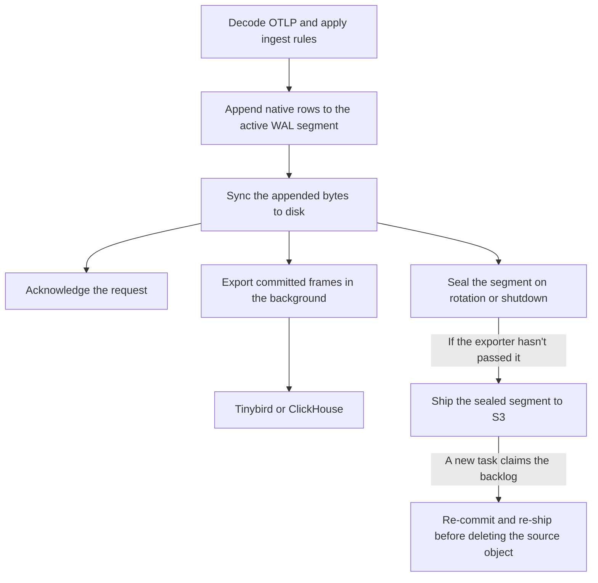

# Ingest WAL durability

The ingest gateway (`apps/ingest`, Rust) acknowledges a request once the rows are committed to a
local write-ahead log, then exports them to Tinybird or ClickHouse in the background. That WAL is
the only copy of an accepted row until it reaches the warehouse. In prd it lives on the EC2 host's
NVMe instance store (`/mnt/wal`, bind-mounted into the task), which survives a reboot but is wiped
when the instance stops or is replaced. On a Fargate task it lives on ephemeral storage, which is
destroyed with the task.

This is how it stays durable.



## Ingest rules

Customer drop and redact rules ([ingest-rules.md](ingest-rules.md)) run in
`process_decoded_payload`, before the payload splits into the native WAL path and the collector
forward. A dropped record is never appended and a redacted value is rewritten first, so the raw
value never reaches the WAL on disk, the segments shipped to S3, or the collector. Replaying a WAL
or an S3 segment therefore never needs the rules again.

## The log

One **lane** per `(shard, destination)` (see `lane_index` in `apps/ingest/src/telemetry.rs`). Lanes
are independent, so a stalled ClickHouse export cannot back up the Tinybird lane sharing its shard.

Each lane is a directory of sealed segments:

```
$INGEST_QUEUE_DIR/shard-003-clickhouse/
  000000000041.seg     ← sealed, waiting to export
  000000000042.seg     ← sealed
  000000000043.seg     ← active; appends land here
  lane.cursor          ← "42 1048576": exported through segment 42, byte 1048576
```

Appends go to the active segment and `sync_data` before the request is acknowledged. At
`INGEST_WAL_SEGMENT_MAX_BYTES` (8 MiB) the segment is **sealed**: the file is closed and the next
one opened. Sealing is an `open` plus a directory fsync. There is no copy on the append path.

Each frame head carries a signal tag (`signal_tag` in `telemetry.rs`). Tags are permanent and only
ever added. A binary that does not know a tag stops reading that segment at the frame, which drops
every later frame in it, whatever org wrote them. So a new tag rolls out in two steps: deploy the
binary that reads it to every task first, then ship whatever writes it. Tag 8 is profiles, read
since 2026-11-16 and written from the deploy after that; never roll a gateway back past the build
that reads a tag while frames carrying it may still be queued.

Syncs are **group commits**. An append writes its frame under the lane's append lock, then waits
for a sync that started after the write. If no sync is running it leads one: it takes every frame
written since the last sync, releases the lock, calls `sync_data`, and on success hands those frames
to the export channel in segment order before waking their appenders. Frames written while that
sync runs join the next one. A request is still acknowledged only after a sync that covers its
bytes; what changed is that one slow fsync now costs a request about two syncs instead of one per
append queued ahead of it on the lane. A failed sync refuses every frame in its batch: none is
delivered or counted as backlog, and each request's org reservation is released. A full segment
takes no more frames until it is synced and sealed, so a segment still overshoots by at most one
frame.

The exporter advances `lane.cursor` and unlinks every segment behind it. **Appends and exports take
different locks**, so an export can never stall a commit. That separation is the fix for the
`ingest.wal_commit` p95 that used to swing between 145ms and 998ms against a flat 3ms p50: the
previous layout was one file per lane, reclaimed by rewriting the unexported tail while holding the
append mutex.

Ordering rules that matter:

- The cursor is written **before** segments are unlinked. A crash in between costs a re-delete on
  the next boot; the other order strands a cursor pointing at bytes that are gone.
- Boot always opens a **fresh** segment, so "sealed" means "will never grow again". That is what
  lets a sealed segment be shipped or deleted without coordinating with the appender.
- A lost or unparseable cursor replays the lane from its oldest surviving segment. Everything here
  is **at-least-once**: replaying an exported frame is a duplicate row, skipping one is silent loss.
- Backlog is `committed - exported` bytes per lane, not anything derived from file sizes, so it
  stays exact across rotation and deletion. The shutdown drain and scale-in protection read it.

## The durability tier

Sealed segments are also shipped to S3 (`apps/ingest/src/wal_store.rs`), so a task that dies without
draining does not take its backlog with it.

```
s3://<bucket>/wal/v1/
  owners/<owner>                              ← heartbeat, refreshed every 60s
  retired/<owner>                             ← written at shutdown; claimable at any age
  claims/<owner>                              ← conditional-PUT claim marker, ETag-fenced
  segments/<owner>/shard-003-clickhouse/000000000041.seg
```

An **owner** is one boot, identified by a fresh UUID (never a task ARN), so a sequence number can
never be reused across boots and a claim can never race a live writer for the same key.

**Shipping.** A sealed segment is announced to a shipper task (`SEGMENT_SHIPPER_WORKERS`, one lane
always handled by the same worker so its events stay ordered). The shipper skips any segment the
exporter has already passed, which in a healthy pipeline is nearly all of them. That is why the
tier costs single-digit dollars a month at ~2B traces: the bucket holds the current backlog, not the
traffic. When a segment exports, its object is deleted.

**Claiming.** On boot, a task lists `owners/`, takes every owner whose heartbeat is older than
`INGEST_WAL_S3_ORPHAN_AFTER_SECS` (10 min), and claims it with a conditional `PUT … If-None-Match: *`.
S3 answers 412 when the key exists, so exactly one task wins without a lock service. The winner
lists that owner's segments and takes them **one at a time**: download, re-commit the frames to its
own lane, seal that lane and **re-ship it under its own owner id, and only then** delete the source
object, so the frames are never only on one task's disk. Memory holds one segment however large the
dead owner's backlog is. A segment that fails any step keeps its source object and the owner stays
claimable, so a later boot retries it (at-least-once); a failed re-commit or re-ship also stops that
owner's recovery, so the rest is not piled onto local disk only to be replayed again. The winner
re-stamps its claim every 5 minutes while that recovery runs. A claim older than 30 minutes is taken
over, because the task that wrote it evidently died before finishing.

**Claim fencing.** Every write to `claims/<owner>` after the first is a `PUT … If-Match: "<etag>"` on
the holder's own last write (the body is unique per write, so each ETag names one write). A takeover
is `If-Match` on the expired claim's listed ETag, so two tasks taking over the same claim cannot both
win. A holder whose renewal gets 412 (or 404) has been taken over: it marks the claim lost, never
writes the claim again, stops recovering at the next segment boundary and deletes no markers. Cleanup
after a full recovery is fenced the same way: a renewal first (which fails if the claim was taken over,
and otherwise starts a fresh 30-minute lease), then a re-listing of the owner's segments (any segment
shipped since recovery listed it keeps the markers), then the heartbeat, retired marker and claim are
deleted inside that lease. S3 has no conditional multi-key delete, so the lease is what bounds the
deletes; a holder would have to stall for 30 minutes between its renewal and its deletes to race a successor.

**Shipping gaps.** A full shipper channel drops a segment event rather than block an append. A lane
seals in sequence, so when a `Sealed` arrives past the one the shipper expected, it ships the skipped
segments too.

**Shutdown.** After `INGEST_SHUTDOWN_DRAIN_SECS`, whatever did not export is sealed and shipped, and
the owner is retired, so the next task claims it immediately instead of waiting out the staleness
window. Retiring stops new heartbeats first, then writes `retired/<owner>` without waiting on a
heartbeat that is still in flight, since that marker alone makes the owner claimable. Deleting the
owner heartbeat does wait for an in-flight heartbeat, so a late refresh cannot recreate the key, but
only for 2 seconds: if a heartbeat is stuck, the key is left and the successor deletes it on release.

Credentials come from the ECS task role (`AWS_CONTAINER_CREDENTIALS_RELATIVE_URI`, refreshed 5
minutes before expiry) unless `INGEST_WAL_S3_ACCESS_KEY_ID`/`_SECRET_ACCESS_KEY` are set. The VPC
has an S3 gateway endpoint and no NAT, so this traffic is free.

## Configuration

| Variable                          | Default                             | Notes                                                   |
| --------------------------------- | ----------------------------------- | ------------------------------------------------------- |
| `INGEST_QUEUE_MAX_BYTES`          | 20 GiB                              | Total WAL budget; divided evenly across lanes           |
| `INGEST_WAL_SHARDS`               | `max(cpus × 2, 2)`                  | Shards, not lanes: lanes are `shards × destinations`    |
| `INGEST_WAL_SEGMENT_MAX_BYTES`    | 8 MiB                               | Seal threshold, and so the shipped object size          |
| `INGEST_WAL_S3_BUCKET`            | unset                               | Unset keeps the WAL local-only (self-hosted, local dev) |
| `INGEST_WAL_S3_REGION`            | `$AWS_REGION`                       | Required with a bucket (either variable)                |
| `INGEST_WAL_S3_ENDPOINT`          | `https://s3.<region>.amazonaws.com` | For an S3-compatible target                             |
| `INGEST_WAL_S3_PREFIX`            | `wal`                               | Key prefix inside the bucket                            |
| `INGEST_WAL_S3_ORPHAN_AFTER_SECS` | 600                                 | How stale a heartbeat must be to be claimable           |
| `INGEST_WAL_S3_HEARTBEAT_SECS`    | 60                                  | Owner heartbeat interval                                |
| `INGEST_WAL_S3_TIMEOUT_MS`        | 10000                               | Per-request timeout                                     |
| `INGEST_SHUTDOWN_DRAIN_SECS`      | 90                                  | Must stay inside the task's 120s `stopTimeout`          |
| `INGEST_QUEUE_MAX_AGE_SECS`       | 300                                 | Age past which a queued frame is shed; 0 disables       |
| `INGEST_REQUEST_TIMEOUT_SECS`     | 30                                  | Gateway request deadline; 0 disables                    |

The bucket, its lifecycle rule (7-day expiry as a backstop for deletes that were lost) and the
task-role policy are in `apps/ingest/alchemy.run.ts`. New objects are encrypted with the WAL's own
KMS key (`alias/<bucket>`, bucket key on), whose policy (`apps/ingest/alchemy/wal-key.ts`) lets only
the gateway's task role, and the prd deploy role, use it through S3. Objects written before the
switch keep the SSE-S3 encryption recorded on each of them and stay readable. The key's policy names
the task role, so the key and the bucket are declared after the ECS service.

## What bounds the backlog

The byte caps bound how much the WAL holds, not how long a frame waits in it, and those are
different limits. A lane's channel holds `INGEST_QUEUE_CHANNEL_CAPACITY` frames (100k) and the WAL
holds `INGEST_QUEUE_MAX_BYTES` (20 GiB), so a stalled downstream target absorbs minutes of traffic
before either cap is reached. For all of those minutes the accept path queues behind it on the
WAL append rather than shedding, because `try_reserve_owned` only refuses once the slots are gone.
Two limits close that gap:

- **`INGEST_QUEUE_MAX_AGE_SECS`** sheds a frame the export worker picks up more than this long after
  it was committed. This is **deliberate data loss** and is metered as `ingest_queue_age_shed_total`
  (per org, destination and datasource). Alert on it. A shed frame still advances the lane cursor
  and releases its org bytes, or it would keep the backlog it was shed to cut. Frames recovered by
  WAL replay are stamped at replay time, so a restart's backlog gets a full window to export in
  rather than being shed on sight for having been written before the restart. Set to 0 to queue
  without an age bound. Audit trail frames are exempt: an audit event is a record, a late one is
  still wanted, and its volume is bounded per org where it is accepted.
- **An open ClickHouse target circuit breaker** defers the batch, with the lane cursor held, for
  one window: one breaker cooldown, at most 30s and at most a quarter of the max queue age. A
  target blip shorter than that is delivered without loss. Past the window that org's batch is
  shed as `shed_circuit_open` (metered as `circuit_open`) and the cursor advances, and later
  batches for the org shed at once until a probe succeeds. A probe that ends in a config-class drop
  (bad or blocked endpoint, redirect, 4xx) gives no verdict on the target: it frees the probe slot
  without closing the breaker or restarting its cooldown. One lane exports every org on its
  shard in turn, so the window is also the most a broken target delays the other orgs there:
  waiting longer would age their frames out instead.
- **`INGEST_REQUEST_TIMEOUT_SECS`** bounds one HTTP request. Without it the accept path had no
  deadline anywhere, so saturation did not surface as errors: requests queued on the WAL append and
  sat there, p95 in the tens of seconds with per-route error rates flat near zero. Timed-out
  requests answer 503 `@maple/ingest/RequestTimeout` with `Retry-After`, and are counted by
  `ingest_request_timeouts_total`.

`ingest_wal_append_duration_seconds` splits into `ingest_wal_lock_wait_duration_seconds` (the
append lock, held only for the write) and `ingest_wal_sync_wait_duration_seconds` (from the write to
the sync that covered it). `ingest_wal_fsync_duration_seconds` is recorded once per sync and
`ingest_wal_sync_batch_frames` says how many frames each sync covered, so their counts divided by
the append count is fsyncs per append. Sync wait near one fsync with batches above 1 is group commit
absorbing a slow device; sync wait well above two fsyncs means the device cannot keep up even
batched, and more lanes only redistribute the same IO. The `ingest.wal_commit` span carries the same
split as `maple.ingest.wal_lock_wait_ms`, `maple.ingest.wal_sync_wait_ms` and
`maple.ingest.wal_batch_frames`.

The gateway's resource attributes name its host: `host.id`, `host.type`, `host.image.id`,
`cloud.availability_zone` and `aws.ecs.task.arn` from the EC2 and ECS metadata endpoints, and
`maple.ingest.wal.device`, `.fs_type`, `.mount_point` and `.device_model` for the filesystem under
`INGEST_QUEUE_DIR`. A host whose fsync is slow can be told apart by AMI or by an instance-store
device that is not actually under the WAL.

## Memory a request may use

One process serves every tenant, so each request works inside one process-wide budget
(`DecodeMemory`, `apps/ingest/src/decode_budget.rs`). Every stage reserves what it is about to
allocate before allocating it, and the reservation is returned when the request ends:

1. The body as received, and the size its gzip trailer declares.
2. The decoded request, estimated from the wire bytes.
3. The rows, built a piece at a time, and the body forwarded to a collector at its full size.

A request that could never fit, even alone, is a 413. One that does not fit right now is a 503
`@maple/ingest/DecodeBusy` with `Retry-After`. Both are decided before a row is built, so a
refused request writes nothing. A forward body only fails to fit an idle budget when the gateway
is configured below the decode limits, so that 413 is a configuration problem, not a batch one.

### Rows are built in pieces

A row repeats its resource, scope and metric strings, so a request's rows are not bounded by its
size: an ordinary 40 MB metrics batch from a JVM service stores about 2 GB of rows. The rows are
therefore never held whole. `row_budget` walks the decoded request once and splits its items
(spans, log records or stored data points, numbered in order) into pieces of about
`ROW_PIECE_BYTES` (8 MiB) of rows each, a single larger row being its own piece. Each piece's
estimate counts its rows with every shared string, and the resource and scope maps it builds.

The request reserves its largest piece once, before anything is written, and holds that
reservation while the pieces are built and appended one after another: build a piece into buffers
sized from its estimate, append its frames to the WAL, then build the next. What a request holds
at once is one piece, whatever it expands to, and requests no longer wait on each other's whole
rows. Every piece goes to the shard the whole request always went to, so its frames stay in order
on one lane. A row that would take its buffer past the estimate is refused before any of it is
written, through a writer bounded by the buffer's reserved size, so the buffer never reallocates
and a wrong estimate is an error, never memory nothing reserved. Under attribute mappings the
estimate assumes every rule copies the longest value either side holds, since a copied value can
be copied again by a later rule, and the gateway applies at most 64 rules with 16 KiB of keys per
org, in a stable order.

### The queue is reserved for the whole request

Before the first piece is built the request reserves everything its pieces will queue
(`TelemetryPipeline::reserve_plan`; profiles, whose rows are built whole, reserve the same way
through `reserve_frames`): its total row bytes against the org's queue
(`INGEST_ORG_QUEUE_MAX_BYTES`), its rows and frame heads under its WAL lane's cap, and one channel
slot per frame. The pieces draw on that reservation instead of reserving one at a time, and what
they do not use is returned when the request ends, however it ends.

- Rows that no reservation could ever hold (more than the org queue cap, the WAL lane's cap, or
  more frames than the lane channel has slots) are a 413 `@maple/ingest/RowsExceedQueue`. Resending
  fails the same way, so it counts in `ingest_org_data_loss_total` as `rows_exceed_queue` and marks
  the span `Error`. The WAL lane cap is `INGEST_QUEUE_MAX_BYTES / (shards x 2)`, so on a small
  host (a preview's 512 MiB lanes, or a self-hosted gateway with many CPUs) it is below the org
  cap and is the real per-request limit. Row bytes are an estimate a few percent over the actual.
- Room that is not free right now is the error the per-frame checks always gave: 429
  `@maple/ingest/OrgQueueThrottled` for the org queue, 429 for a full channel, 503
  `@maple/ingest/QueueUnavailable` for a full WAL lane. Nothing is written, so the resend is clean.

Committed pieces wait in their lane's channel, payload in memory, until exported. Per request that
is at most its org reservation, and per process the rows in flight are bounded by the decode budget
(one piece per request being built) plus every org's queued bytes, each up to
`INGEST_ORG_QUEUE_MAX_BYTES`; there is no single process-wide cap on the second term beyond the WAL
cap (`INGEST_QUEUE_MAX_BYTES`), which counts the same frames on disk.

The whole plan counts against its lane's cap from the start, so other requests on that lane can
get a 503 until its pieces are written. That lasts as long as building and syncing the pieces
(the body is already decoded, so a client cannot slow it), at most the 30 s request timeout. The
cap check runs outside the lane's append lock, so a racing append can pass the cap by one frame.

A request is acknowledged only once every piece is durable. With the room reserved up front, it
can still fail after part of it was written in only these ways. A piece holds up to four frames
(one per metrics datasource), so "part" can be a frame of the first piece:

- The WAL write or its sync fails (disk I/O), or the lane's writer is gone.
- The request is dropped mid-way: the 30 s request timeout, or the client disconnecting. Frames
  already appended are exported. The frame being appended when it drops reaches disk without being
  queued, so it is exported only if the process restarts before the export cursor passes it.
- The process dies mid-way; replay exports the frames already in the WAL.
- A piece's rows exceed their estimate (a gateway bug, never seen in the equality tests).

The written frames are exported, and a resend stores them again: the at-least-once duplicate the
WAL already allows. The answer says so instead of claiming nothing was written, the span records
`maple.ingest.row_pieces_written` (whole pieces), and `ingest_partial_write_total` counts any
request with at least one frame written, by signal and reason
(`cancelled` for a dropped request). An encode failure after a written frame stays non-retryable and
counts in `ingest_org_data_loss_total` as `encode_partial`, since only the unwritten part is lost.

`ingest.encode_rows` (one per piece) records the estimate (`maple.ingest.row_bytes_estimate`)
beside what was written (`maple.ingest.payload_bytes`), and `ingest.accept` records
`maple.ingest.row_pieces`.

### Row expansion

Usage is metered on the decoded bytes, not on the rows. `INGEST_MAX_ROW_EXPANSION` bounds how far
apart the two can be: a request whose rows come to more than that many times its metered bytes is
a 413 `@maple/ingest/RowExpansion`, decided from the whole request before its first piece, so
nothing is written. Besides it, the row stage refuses for size only rows larger than the queue can
hold (`rows_exceed_queue`, above). It counts in
`ingest_org_data_loss_total` as `row_expansion` and marks the span `Error` (`rejection_loses_data`).
Real telemetry stores 3 to 13 times its decoded size, and up to 200 times when a long resource
attribute such as a JVM command line sits on every row of small items. The only other refusal is a
single item whose own row cannot fit the whole budget beside its decoded request, which no
telemetry comes near; it is a 413 counted as `payload_too_large`.

| Variable                        | Default | Notes                                                    |
| ------------------------------- | ------- | -------------------------------------------------------- |
| `INGEST_MAX_REQUEST_BODY_BYTES` | 20 MiB  | Body as received                                         |
| `INGEST_MAX_DECODED_BODY_BYTES` | 8x body | Body after gzip                                          |
| `INGEST_MAX_DECODE_HEAP_BYTES`  | 768 MiB | One request's decoded form                               |
| `INGEST_MAX_ROW_EXPANSION`      | 512     | Rows as a multiple of the metered bytes; 0 turns it off  |
| `INGEST_DECODE_MEMORY_BYTES`    | 1 GiB   | Shared by all requests; at least one request plus 16 MiB |
| `INGEST_ORG_QUEUE_MAX_BYTES`    | 1 GiB   | Most rows one request may store; reserved up front       |
| `INGEST_QUEUE_CHANNEL_CAPACITY` | 100,000 | Most frames one request may store (one per datasource and piece) |

Frames waiting in a lane's channel are not in this budget: they are bounded per org by
`INGEST_ORG_QUEUE_MAX_BYTES` and per lane by the channel capacity.

## Metrics

| Metric                                  | Read it for                                                        |
| --------------------------------------- | ------------------------------------------------------------------ |
| `ingest_wal_shard_bytes`                | Bytes a lane holds on disk, exported prefix included               |
| `ingest_wal_shard_full_total`           | Appends rejected because a lane hit its cap: customer-visible 429s |
| `ingest_wal_segments_sealed_total`      | Segment rotation rate                                              |
| `ingest_wal_reclaimed_bytes_total`      | Bytes freed by deleting exported segments                          |
| `ingest_wal_shipped_bytes_total`        | Bytes that reached the bucket                                      |
| `ingest_wal_ship_outcomes_total`        | `outcome=exported_first` (healthy), `queue_full`, `failed`         |
| `ingest_wal_frames_recovered_total`     | Frames claimed from a dead task; non-zero means a task died dirty  |
| `ingest_wal_commit_bytes`               | Per-append size; the `ingest.wal_commit` span carries the latency  |
| `ingest_wal_sync_batch_frames`          | Frames per group-commit sync; its count is the fsync count         |
| `ingest_wal_sync_wait_duration_seconds` | Write to covering sync, per append                                 |
| `ingest_partial_write_total`            | Requests that failed after part of their rows were durable         |

`queue_full` means the object store cannot keep up with segment rotation, and those segments stay
local-only. Sustained non-zero is the signal that the durability tier is not actually covering the
backlog.

## What is deliberately not here

A real stream (Kinesis, MSK, S2) buys ordered replay for multiple independent consumers. There is
one consumer, per-GB pricing hurts at trace volume, and MSK has a ~$500/month floor. Revisit only
when a second consumer or replay-as-a-feature is a requirement.
